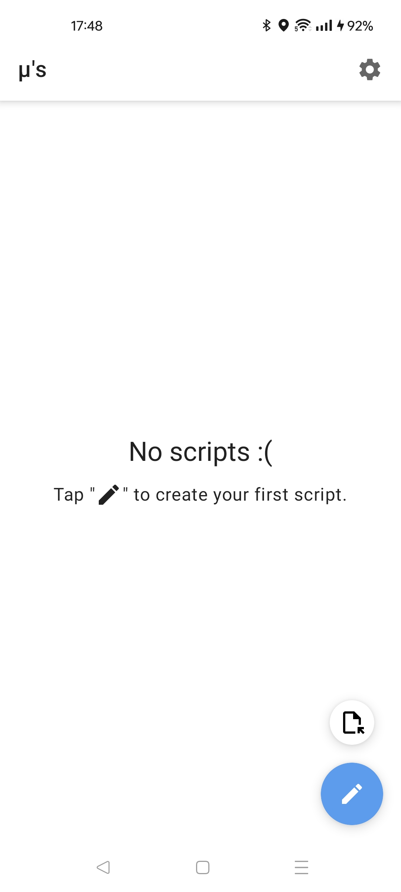
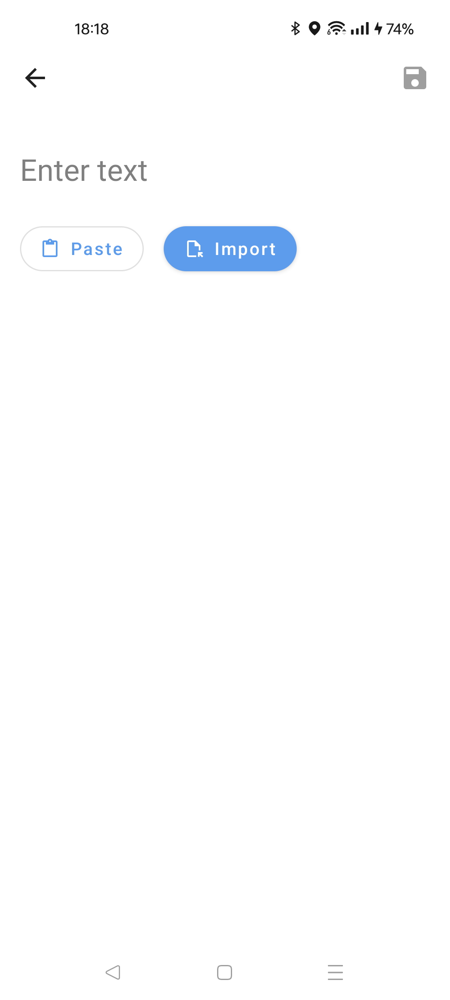
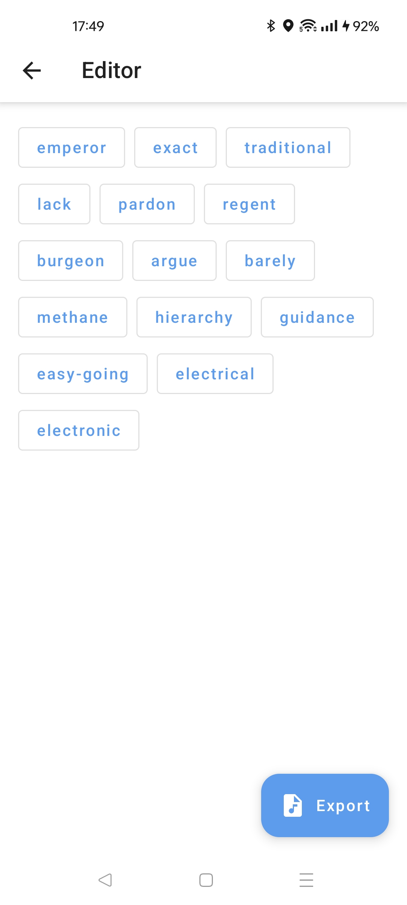
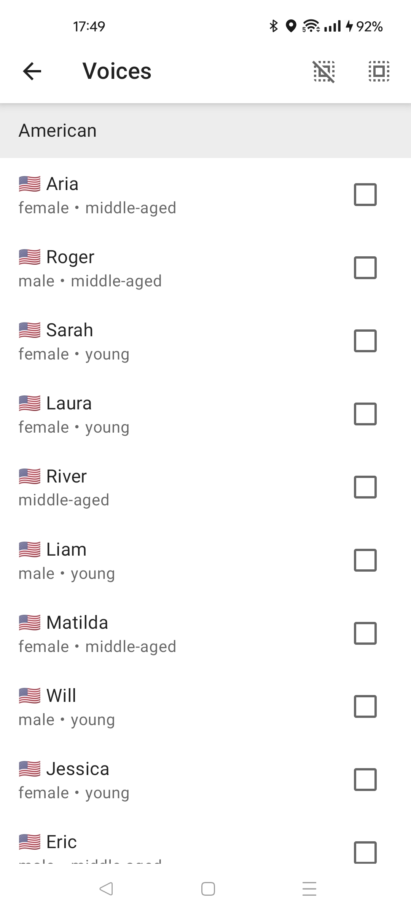
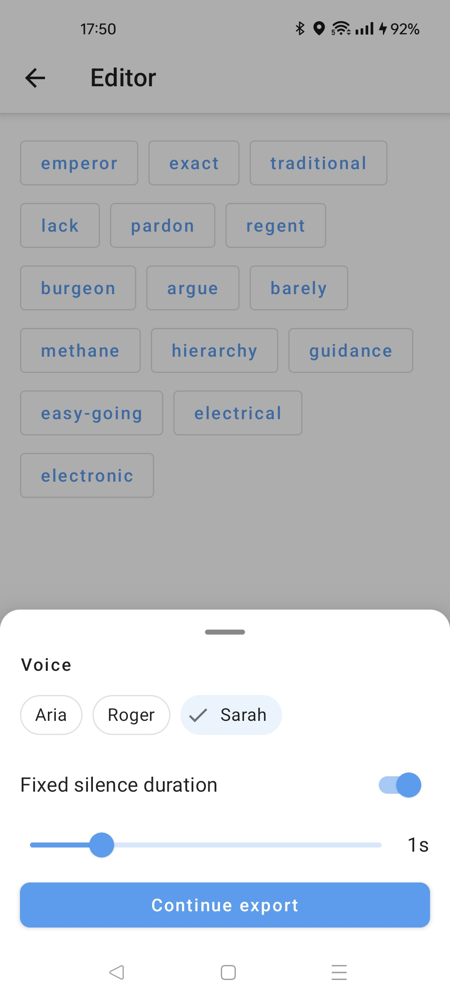
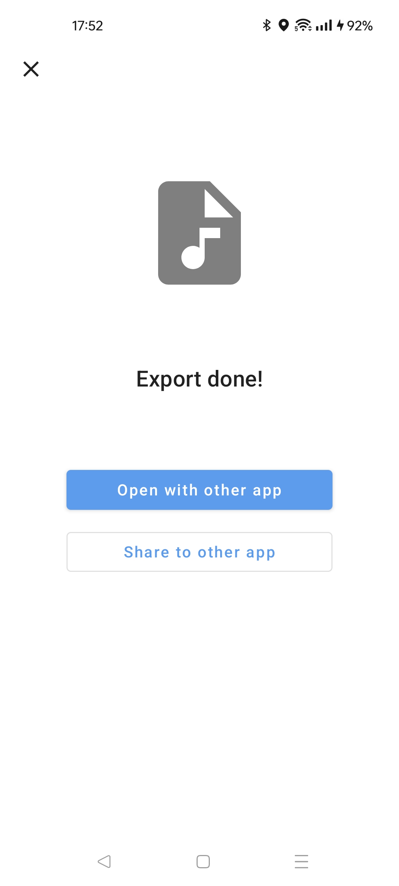

### Muse

Text to Speech

 

#### 🧪 Now in closed testing on Google Play

Muse needs **12 testers** before Google will let it go live. Two steps, about a minute:

1. **Join the tester group** — https://groups.google.com/g/muse-tester
2. **Opt in and install** — https://play.google.com/apps/testing/io.github.kkoshin.muse

Google counts testers who stay opted in for 14 days — no need to open the app daily. Generating speech needs your own [ElevenLabs](https://elevenlabs.io) API key.

#### Preview

  

  

#### iOS Support
The latest version (v0.2.0 and above) supports building for iOS. You can use the `run_ios.sh` script to execute the iOS build process.

#### Other ways to install

Outside of the Play closed test, stable releases are also published to [F-Droid](https://f-droid.org/packages/io.github.kkoshin.muse) and the [GitHub releases page](https://github.com/kkoshin/Muse/releases).

